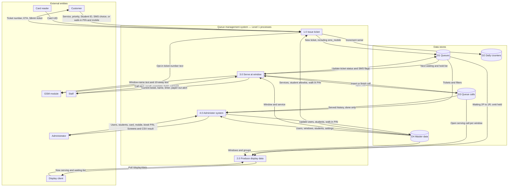

# Level 1 data flow diagram — queue system

**Context:** Physical **system boundary** = the Laravel web application + MySQL on the kiosk/server PC, plus the local card-reader, printer, and GSM helpers.  
**Level 1** decomposes that system into **four major processes**, four **logical data stores**, and **six external entities**. Walk-in tickets are issued at the kiosk with a PIN (`settings.walkin_pin`); there is no Guard login. SMS is opt-in and leaves through the SIM7600 on this same PC. No COM port is configured.

---

## Diagram (Mermaid)

Paste into [mermaid.live](https://mermaid.live) or open `dfd-level1.mmd`. The same diagram is on `/flowchart-viewer.html`. For printing, export **SVG** and use **Landscape** or **Fit to page**.

### Data store definitions

| ID | Maps to tables (logical) | Contents |
|----|---------------------------|----------|
| **D1** | `queues` | Ticket rows: number, service, optional `student_id`, optional `issued_by`/`issue_reason` (walk-in), optional `sms_mobile`, `sms_issued`, `sms_near`, priority, status (`waiting`/`serving`/`done`/`cancelled`/`held`), date |
| **D2** | `daily_queue_counters` | Per service per day: last issued serial |
| **D3** | `queue_calls` | Links queue to window: called / finished times (open = `finished_time` null) |
| **D4** | `services`, `windows`, `users`, `students`, `settings` | Service prefixes, window groups, accounts (guard issuer cannot log in), Student ID allowlist with optional `card_uid` and `mobile`, kiosk walk-in PIN |

SMS files (`storage/app/sms-outbox`) and helper status files (`kiosk-card.json`, `kiosk-printer.json`, `kiosk-gsm.json`) are local hand-offs on the kiosk PC. They are not database stores.

### Process definitions

| ID | Name | Typical controller / route |
|----|------|------------------------------|
| **1.0** | Issue ticket | `KioskController@store`, `GET /kiosk/student`, `GET /kiosk/card`, `POST /kiosk/walk-in/unlock`, `POST /kiosk/walk-in`. Enqueues the ticket-number text when SMS was chosen. |
| **2.0** | Produce display data | `DisplayController@index`, `DisplayController@data`. Numbers only. Held tickets are omitted. |
| **3.0** | Serve at window | `WindowController` call-next / recall / complete / hold / call-held. After call or recall, enqueue the window-name text. After call or hold, enqueue the 10-away text for tickets that just entered that range. |
| **4.0** | Administer system | `AdminDashboardController`, `UserManagementController`, `StudentManagementController`, `SettingsController`, `GuardIssueController`, `HistoryController` |

### External entities

| Entity | Role |
|--------|------|
| **Customer** | Uses the public kiosk (Student ID, card tap, or walk-in PIN). No login. |
| **Card reader** | ACR122U on the kiosk PC. Writes the last UID for the confirm step. |
| **GSM module** | SIM7600 on the kiosk/server PC. Sends the three opt-in texts. The app does not set its COM port. |
| **Staff** | Logged-in counter user tied to one window. Sees the paper-out alert. |
| **Administrator** | Full admin routes, including students, kiosk PIN, and optional `/guard` issue |
| **Display client** | Browser on TV/monitor; read-only public display |

---

## Level 0 (context) — optional one-page summary

For documentation sets that require a **context diagram**: draw a single process **0.0 Queue management system** with the same six external entities and a single bidirectional “queue data” bundle to MySQL; this Level 1 diagram is the decomposition of **0.0**.

---

*PECIT queue system — aligns with `routes/web.php` and domain tables.*
